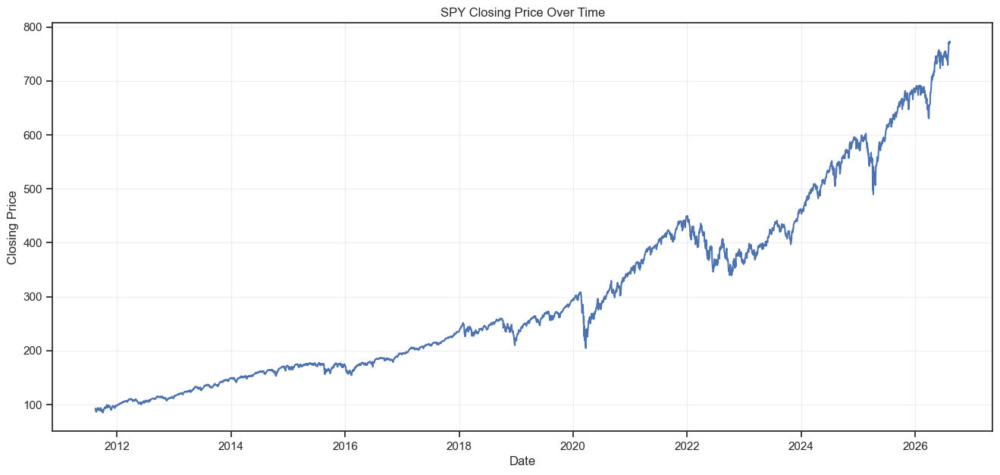
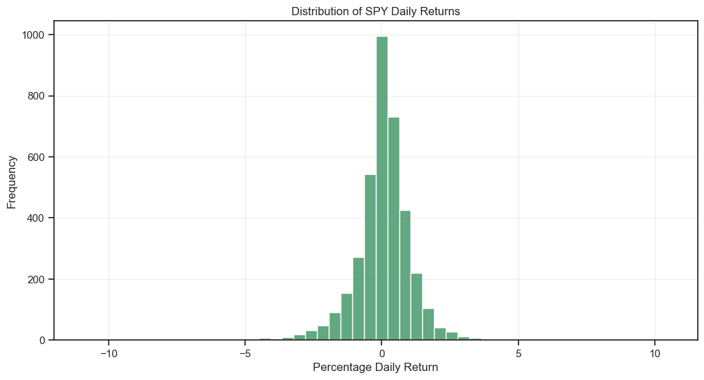
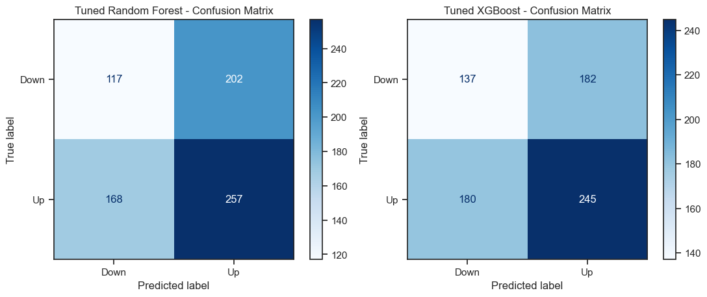
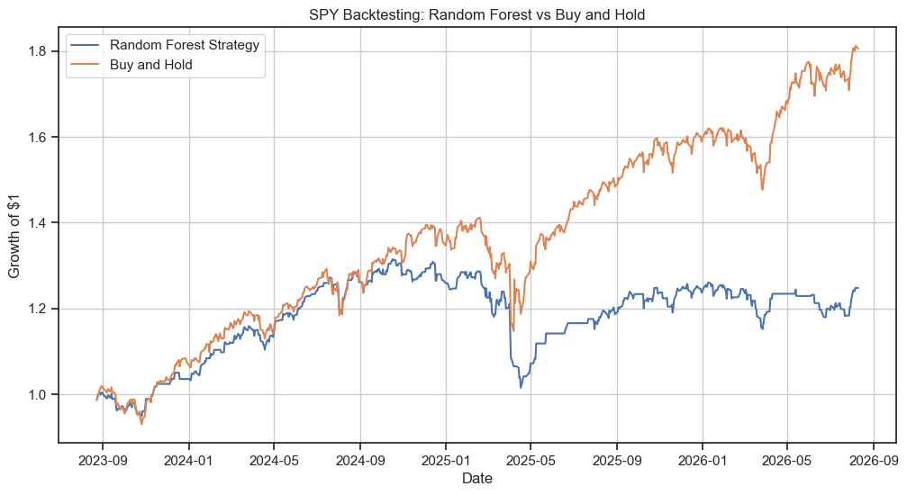
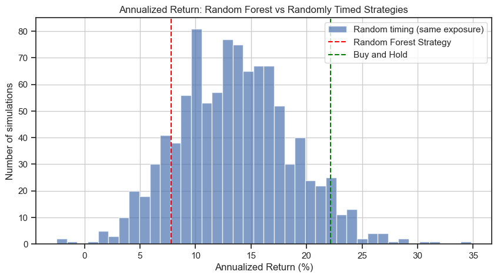

<div align="center">

# SPY Next-Day Direction Predictor

**A leakage-free machine learning study of whether technical indicators can predict tomorrow's move in the S&P 500 ETF, validated with a realistic backtest.**


</div>

---

## Table of Contents

- [Overview](#overview)
- [Headline Result](#headline-result)
- [Data](#data)
- [Methodology](#methodology)
- [Features](#features)
- [Model Results](#model-results)
- [Backtest](#backtest)
- [Key Lessons](#key-lessons)
- [Limitations](#limitations)
- [Repository Structure](#repository-structure)
- [Getting Started](#getting-started)
- [Reproducibility Notes](#reproducibility-notes)
- [Disclaimer](#disclaimer)

---

## Overview

This project asks a simple but hard question: **can widely used technical indicators predict whether SPY will close higher or lower tomorrow?**

It frames the problem as binary classification and works through the full machine learning workflow on 15 years of daily data: data collection, cleaning, exploratory analysis, feature engineering, a strictly chronological train/test split, model comparison, hyperparameter tuning with time-series cross-validation, and a backtest of the resulting trading strategy against buy-and-hold.

The emphasis is on **methodology and honest evaluation** rather than on producing an impressive-looking number. Every step is designed to avoid data leakage, and every result is compared against a meaningful baseline.

## Headline Result

> [!IMPORTANT]
> **The models found no usable predictive signal.** Across Logistic Regression, Random Forest, and XGBoost (before and after tuning), no model beat the naive "always predict Up" baseline, and every ROC-AUC sat close to 0.5, which is the level of random guessing.

This is a legitimate finding, not a bug. It is consistent with the efficient market hypothesis: indicators like RSI, MACD, and moving averages are public, widely traded on, and already reflected in prices. The value of this project is showing the process that leads to that conclusion rigorously, including checks that rule out the common ways such a result can be wrong.

| Question | Answer |
|---|---|
| Did any model beat the naive baseline (57.12% accuracy)? | No |
| Did hyperparameter tuning help? | No meaningful change |
| Did the Random Forest strategy beat buy-and-hold? | No (24.8% vs 80.5% total return) |
| Was the model's timing better than random timing? | No (it beat only about 14% of randomly timed strategies) |

## Data

| Item | Detail |
|---|---|
| Asset | SPY (SPDR S&P 500 ETF Trust), an ETF tracking the S&P 500 index |
| Source | [`yfinance`](https://github.com/ranaroussi/yfinance), daily OHLCV |
| Date range | 2011-08-15 to 2026-08-12 |
| Raw rows | 3,770 trading days |
| Modeling rows | 3,720 (49 lost to rolling-window warm-up, 1 lost because the last day has no "tomorrow") |
| Train set | 2,976 rows (2011-10-24 to 2023-08-22) |
| Test set | 744 rows (2023-08-23 to 2026-08-11) |
| Class balance | 55.2% Up days overall (54.7% in train, 57.1% in test) |

SPY was chosen over a single stock because an index fund is smoother and less affected by company-specific news, which makes it a cleaner test of whether any generalizable pattern exists.

<p align="center">
  
</p>

The sample spans several very different market regimes, including the 2020 COVID crash and the April 2025 tariff-driven volatility (which contains both the largest down day, -5.85% on 2025-04-04, and the largest up day, +10.50% on 2025-04-09, in the post-2020 data).

<p align="center">
  
</p>

Daily returns cluster tightly around zero with fat tails on both sides, meaning large moves are rare but real.

## Methodology

The workflow follows a strict order so that nothing from the future ever reaches the model.

**1. Data collection and cleaning.** Raw data is pulled once and saved untouched to `data/raw.csv`. Cleaning flattens yfinance's MultiIndex columns, verifies chronological order, and checks for nulls, duplicates, and broken values (none found). The cleaned file is saved separately as `data/processed.csv`.

**2. Exploratory analysis.** Price trend, daily returns and their distribution, extreme-return days (matched against known market events), volume, and rolling volatility.

**3. Feature engineering.** Technical indicators are computed from information available at each day's close. Rolling-window warm-up rows are dropped rather than imputed.

**4. Target definition.** `Target = 1` if tomorrow's close is strictly higher than today's close, otherwise `0`. There is no minimum-move threshold.

**5. Chronological split.** The first 80% of days train the model and the most recent 20% test it. There is no shuffling anywhere, and the date ranges are explicitly verified not to overlap.

**6. Preprocessing.** A `StandardScaler` is fit on the training set only and applied to the test set. The binary `MA Trend` flag is left unscaled.

**7. Modeling.** Logistic Regression, Random Forest, and XGBoost are compared against a naive baseline using accuracy, precision, recall, F1, and ROC-AUC.

**8. Tuning.** Random Forest and XGBoost are tuned with Optuna (30 trials each), scoring on ROC-AUC with `TimeSeriesSplit` (5 folds) so validation folds always come after their training folds.

**9. Backtest.** The tuned Random Forest, chosen using cross-validation scores only (never test results), is traded as a long-or-cash strategy and compared with buy-and-hold and with randomly timed strategies.

## Features

Thirteen engineered features are used. All are relative or bounded measures rather than raw price levels.

| Feature | Category | What it captures |
|---|---|---|
| `Daily Returns` | Momentum | Today's percentage change |
| `Return Lag 1`, `Return Lag 2` | Momentum | Returns from one and two days ago |
| `10d MA Distance`, `50d MA Distance` | Trend | Percentage distance of price from its 10-day and 50-day moving averages |
| `MA Trend` | Trend | 1 if the 10-day average is above the 50-day average |
| `RSI` | Momentum | 14-day relative strength index (overbought/oversold) |
| `MACD`, `MACD Signal`, `MACD Histogram` | Trend + momentum | 12/26-day EMA difference, its 9-day signal line, and the gap between them |
| `BB %B` | Volatility | Position of price within its 20-day Bollinger Bands |
| `Rolling Volatility` | Volatility | 20-day standard deviation of returns |
| `Volume Ratio` | Volume | Today's volume relative to its 20-day average |

<details>
<summary><b>Why raw prices and moving averages were excluded</b></summary>

<br>

SPY traded near $90 in 2011 and near $770 in 2026. A model that learns a pattern tied to a price level (for example "price above $95") cannot carry it across those regimes. Raw `Open/High/Low/Close`, the raw moving averages, and the raw Bollinger Bands all carry that absolute scale, so they were replaced with percentage distance from a moving average and the bounded `%B` measure. Intermediate calculation columns (gains, losses, EMAs, and so on) were also dropped as redundant.

`MACD` is built from price differences and still drifts mildly with price level. It was kept because it is conventionally read by sign and crossover, and this is noted as a known limitation.

</details>

## Model Results

All results are on the held-out test set (744 days, 2023-08-23 onward).

| Model | Accuracy | Precision | Recall | F1 | ROC-AUC |
|---|---|---|---|---|---|
| Naive baseline (always Up) | **57.12%** | n/a | n/a | n/a | n/a |
| Logistic Regression | 56.32% | 0.570 | 0.958 | 0.715 | 0.478 |
| Random Forest | 52.15% | 0.588 | 0.544 | 0.565 | 0.516 |
| XGBoost | 51.48% | 0.577 | 0.565 | 0.571 | 0.508 |
| Tuned Random Forest | 50.27% | 0.560 | 0.605 | 0.581 | 0.508 |
| Tuned XGBoost | 51.34% | 0.574 | 0.576 | 0.575 | 0.506 |

<p align="center">
  
</p>

**How to read this:**

- **ROC-AUC is the honest metric here.** A value of 0.5 means the model cannot rank Up days above Down days any better than chance. Every model sits within about 0.02 of 0.5. With 744 test samples the standard error on ROC-AUC is roughly 0.02, so all of these values, including Logistic Regression's 0.478, are statistically indistinguishable from random guessing.
- **Accuracy alone is misleading.** Logistic Regression's 56.3% accuracy looks close to the baseline, but its recall of 0.958 shows it simply predicts "Up" almost every day.
- **Tuning did not help.** Cross-validated ROC-AUC during tuning was about 0.5225 (Random Forest) and 0.5177 (XGBoost), and on the test set the tuned models scored slightly below their untuned versions. Differences of a percentage point in accuracy or F1 are within noise.
- **Feature importance is flat and inconsistent.** Importances are spread almost evenly (roughly 0.06 to 0.10 each, apart from `MA Trend` in Random Forest, which is near zero), and the two models disagree on what matters most: Random Forest ranks `Return Lag 2` first, while XGBoost ranks `MA Trend` first. When a model finds real signal, importance tends to concentrate on a few features and agree across models. An even, unstable spread is what fitting noise looks like, so no single feature's rank should be read as predictive.

## Backtest

The tuned Random Forest was converted into a simple strategy: **hold SPY overnight when the model predicts Up, stay in cash when it predicts Down.** There is no shorting, leverage, or position sizing. Each prediction is paired with the *following* day's return so the model cannot trade on a move it already knew about.

Period: 2023-08-23 to 2026-08-10 (743 trading days), the untouched test window.

<p align="center">
  
</p>

| Metric | Random Forest Strategy | Buy and Hold |
|---|---|---|
| Total return | 24.79% | 80.54% |
| Annualized return | 7.80% | 22.19% |
| Annualized volatility | 11.96% | 15.42% |
| Sharpe ratio | 0.688 | 1.376 |
| Max drawdown | -22.82% | -18.76% |
| Time invested | 61.8% | 100% |

The strategy had lower volatility only because it spent about 38% of the time in cash, and in doing so it missed a large share of the market's gains. Its Sharpe ratio was about half of buy-and-hold's, and its maximum drawdown was deeper (-22.8% versus -18.8%).

### Is the timing better than chance?

Beating buy-and-hold is a low bar during a strong bull market, because any strategy that sits in cash part of the time will lag. A fairer question is whether the model's *timing* adds anything beyond being invested less often.

To test this, the model's own predictions were randomly shuffled 1,000 times. Each shuffle keeps the exact same number of invested days (the same market exposure) but places them on random dates.

<p align="center">
  
</p>

- Randomly timed strategies with the same exposure averaged an annualized return of about **13.5%** (5th to 95th percentile: roughly **5.6% to 22%**), compared with about **8%** for the Random Forest strategy.
- The Random Forest strategy beat roughly **14%** of the randomly timed strategies. That places it toward the low end of the random distribution but still above the 5th percentile, so its timing cannot be distinguished from chance at conventional thresholds. If anything, it was worse than most random timings, not better.
- Buy-and-hold (about 22%) sits right at the 95th percentile of the random distribution, so no timed strategy, random or model-based, reliably improved on simply staying invested.

### Effect of transaction costs

The figures above ignore trading costs. The model changed position 224 times over the 743 trading days, and charging just 0.1% per position change erases the strategy's remaining gain: total return falls from 24.79% to -0.26% (Sharpe ratio from 0.69 to 0.05). Buy-and-hold, which trades once, is nearly unaffected at 80.35%.

## Key Lessons

Working through the project surfaced several problems that are easy to miss and worth documenting:

1. **CSV round-trips can silently break MultiIndex columns.** Saving yfinance's two-level column headers to CSV and reading them back with default settings turned the header rows into fake data rows and forced every column to a string type. The fix was to reconstruct the header explicitly on read and flatten it in code, rather than hand-editing the file.
2. **Comparisons with NaN return `False`, not NaN.** The last row's target (no "tomorrow") silently became `0` instead of missing, so `dropna()` could not catch it. The row is dropped explicitly instead.
3. **Absolute-price features hide a scale problem.** Moving averages and Bollinger Bands look harmless but carry the same price-level drift as raw prices. Converting them to relative measures was necessary for the features to generalize across 15 years.
4. **Accuracy can mislead on imbalanced data.** A model that predicts "Up" almost every day scored close to the baseline on accuracy while having no ranking ability at all. ROC-AUC exposed this immediately.
5. **Beating buy-and-hold is the wrong test in a bull market.** Comparing against randomly timed strategies with matched exposure gives a far more meaningful verdict on whether a model's timing has value.
6. **Select models using validation data, not test data.** The backtest model was chosen from cross-validation scores before any test-set result was examined, avoiding quiet cherry-picking.
7. **Without a real signal, results depend heavily on the random seed.** Before the tuning was seeded, a rerun selected a different Random Forest and produced a noticeably different backtest (about 43% total return, versus 25% in the final seeded run). The conclusions never changed (ROC-AUC near 0.5, underperforming buy-and-hold, timing within the range of chance), but the swing itself is a symptom of models fitting noise. All randomness is now seeded so the reported numbers are reproducible.

## Limitations

- The test period (August 2023 to August 2026) was a strong bull market, so any strategy holding cash was likely to lag.
- Results cover a single asset over a single period and should not be generalized.
- The model was trained once and not retrained during the three-year test window. A live system would retrain periodically.
- Sharpe ratios assume a 0% risk-free rate, so days in cash earn nothing.
- The main backtest ignores slippage, taxes, and (in the headline figures) transaction costs.
- Only price- and volume-derived indicators were used. No fundamental, macroeconomic, or sentiment data was included.
- `MACD` features retain a mild dependence on price level.

## Repository Structure

```
Stock-Price-Direction-Predictor/
├── data/
│   ├── raw.csv                # untouched yfinance pull
│   ├── processed.csv          # cleaned data
│   └── features.csv           # engineered features
├── notebooks/
│   └── analysis.ipynb         # full workflow: data -> features -> models -> backtest
├── outputs/                   # plots used in this README
├── README.md
├── requirements.txt
└── .gitignore
```

## Getting Started

**1. Clone the repository**

```bash
git clone https://github.com/Junaid-Haider/Stock-Price-Direction-Predictor.git
cd Stock-Price-Direction-Predictor
```

**2. Create a virtual environment (recommended) and install dependencies**

```bash
python -m venv .venv
source .venv/bin/activate        # Windows: .venv\Scripts\activate
pip install -r requirements.txt
```

**3. Run the notebook**

```bash
jupyter notebook notebooks/analysis.ipynb
```

Run cells from top to bottom. Python 3.10 or newer is required (developed on Python 3.14).

## Reproducibility Notes

- **Data.** The committed `data/raw.csv` is the exact dataset used for every reported result. Re-downloading from Yahoo Finance later can produce slightly different values (for example, revised adjusted prices), so to reproduce the numbers exactly, load the saved CSV instead of re-running the download cell.
- **Randomness.** All randomness is seeded with 42: the model `random_state`, the Optuna `TPESampler` seed for both tuning studies, and the random-exposure generator. Re-running the notebook on the committed `data/raw.csv` in the same environment should reproduce the reported results. Different library versions or hardware can still introduce small numerical differences.

## Disclaimer

This project is for educational purposes only. It is not financial advice, and nothing here should be used to make investment decisions. Past performance, including in backtests, does not guarantee future results.

---

<div align="center">

Built by [Junaid Haider](https://github.com/Junaid-Haider)

</div>
